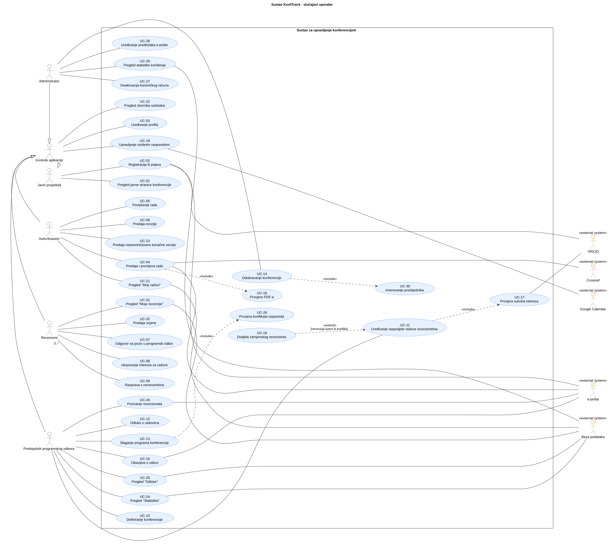

# 3. Obrasci uporabe

**Cilj:** Prikazati glavne interakcije između aktera aplikacije i sustava. Opišite kako akter ostvaruje cilj i što se događa kada važan korak ne uspije. Interakcije temeljite na odobrenim zahtjevima i ažurirajte ih kako se aplikacija razvija.

## 3.1 Dijagram obrazaca uporabe

**Cilj:** Prikazati granicu sustava, relevantne aktere i njihove glavne ciljeve u **preglednom UML dijagramu obrazaca uporabe**. Ako je za razumijevanje pojedinog dijela sustava potrebno prikazati više detalja, taj dio izdvojite u dodatni usmjereni dijagram. Dodatni dijagrami trebaju produbiti dio preglednog modela, a ne stvarati nepovezane ili duplicirane prikaze istog sustava.

**Slika 3.1. Dijagram obrazaca uporabe sustava KonfTrack**

**PlantUML izvor:** [izvor](./puml/3-1-KonfTrack.puml)

**Provjera dijagrama:** Prikažite prepoznate uloge koje **komuniciraju s aplikacijom**, a ne dionike koji s njom nemaju interakciju. Svaki glavni korisnički cilj mora imati pridruženog aktera; uključeni obrazac uporabe može se dosegnuti preko drugog obrasca uporabe bez vlastite izravne veze s akterom. `<<include>>` i `<<extend>>` koristite samo kada odnos odgovara stvarnom ponašanju.

<strong>Primjer aktera i granica sustava</strong>

**Opis primjera — CrisisMap:**

Dijagram prikazuje **ogledni scenarij** s građaninom, posjetiteljem i koordinatorom pomoći te vanjskim pružateljem identiteta. Pružatelj identiteta sudjeluje u obrascu uporabe „Prijava u sustav” kao sekundarni akter: korisnik pokreće prijavu u aplikaciji, a vanjski sustav provodi autentikaciju. Budući da projekt koristi vanjskog pružatelja identiteta, ta se ovisnost prikazuje i u dijagramu obrazaca uporabe; tehnički detalji integracije pripadaju arhitekturnoj dokumentaciji.

**Odabir aktera i ciljeva:** Granica pokazuje što aplikacija nudi, akteri imaju različite ciljeve, a nijedan akter ni obrazac uporabe ne tvrdi da ova studentska aplikacija angažira hitne službe. Dijagram usporedite s odobrenim funkcijskim zahtjevima i akterima.

**Pet pitanja za odabir sadržaja dijagrama** (ne pet dijagrama za predaju):

| Fokus | Pitanje |
| --- | --- |
| Cijeli sustav | Koji korisnički ciljevi najbolje objašnjavaju čemu ova aplikacija služi? |
| Ključne funkcionalnosti | Koje ciljeve treba detaljnije opisati ili, ako je potrebno, prikazati zasebnim usmjerenim dijagramom? |
| Korisničke uloge | Koji akteri mogu sudjelovati u pojedinom cilju i kako se njihove ovlasti razlikuju? |
| Ključni procesi | Koji cilj ima važne alternative koje treba opisati u obrascu uporabe? |
| Vanjske integracije | Sudjeluje li drugi sustav u obrascu uporabe kao **sekundarni akter**, primjerice odobreni pružatelj identiteta pri prijavi? |

Vanjski sustav može biti sekundarni akter obrasca uporabe kada sudjeluje u ostvarenju korisničkog cilja; tehničke veze opisuju se u arhitekturi. Nemojte stvarati dodatni obavezni dijagram obrazaca uporabe samo radi popisa integracija. Prenatrpan dijagram podijelite prema povezanim akterima ili ciljevima samo kada time postaje čitljiviji.

## 3.2 Specifikacije obrazaca uporabe

**Cilj:** Za svaki obrazac uporabe iz dijagrama objasniti cilj aktera, uobičajenu interakciju s aplikacijom i važne alternative. Jednostavne obrasce uporabe opišite kratko; proširite one kod kojih alternative, vanjske ovisnosti ili posljedice zahtijevaju dodatno objašnjenje.

**Za svaki obrazac uporabe koristite jednu okomitu tablicu.** Navedite samo onoliko pojedinosti koliko interakcija zahtijeva; neprimjenjivu alternativu izostavite umjesto da je popunjavate samo radi forme.

**KonfTrack**

## 3.2 Specifikacije obrazaca uporabe

**Opća pravila:** (F-004) Isti korisnik može imati različite uloge na različitim konferencijama, a ovlasti se određuju zasebno za svaku konferenciju. (F-007) Nakon isteka roka sustav onemogućuje odgovarajuće radnje (predaja, recenzije, obavijesti, konačne verzije).

**UC-01: Pregled javne stranice konferencije.**

| Polje | Opis |
| --- | --- |
| Primarni akter | Javni posjetitelj (A-01) |
| ID zahtjeva | F-003, F-027 |
| Preduvjeti, ako postoje | Konferencija je aktivna. |
| Glavni tijek | 1. Posjetitelj otvara javnu stranicu konferencije. 2. Sustav prikazuje poziv na predaju radova, teme i važne datume. 3. Ako je program objavljen, sustav ga prikazuje; ako je objavljen zbornik sažetaka, sustav omogućuje njegovo preuzimanje. |
| Alternativni ili neuspješni tijekovi, ako postoje | **3a — Program nije objavljen:** sustav ga ne prikazuje. **3b — Zbornik nije objavljen:** sustav ga ne prikazuje. |
| Rezultat | Posjetitelj vidi javne podatke konferencije bez prijave. |

**UC-02: Registracija ili Prijava.**

| Polje | Opis |
| --- | --- |
| Primarni akter | Javni posjetitelj (A-01); sekundarni akter: ORCID (A-06) |
| ID zahtjeva | F-001 |
| Preduvjeti, ako postoje | Nema. |
| Glavni tijek | 1. Posjetitelj odabire registraciju ili prijavu. 2. Posjetitelj bira način: adresa e-pošte ili ORCID račun. 3. Sustav provodi autorizaciju OAuth 2.0 protokolom (tokeni). 4. Sustav prijavljuje korisnika i otvara mu radnje za prijavljene. |
| Alternativni ili neuspješni tijekovi, ako postoje | **2a — Adresa e-pošte već postoji:** sustav objašnjava zašto se registracija ne može nastaviti. **3a — ORCID autorizacija nije uspjela:** korisnik ostaje neprijavljen i sustav objašnjava kako pokušati ponovno. |
| Rezultat | Korisnik je prijavljen i može izvršavati radnje za prijavljene; neprijavljeni ih ne može izvršiti. |

**UC-03: Uređivanje profila.**

| Polje | Opis |
| --- | --- |
| Primarni akter | Prijavljeni korisnik (Autor/Koautor, Recenzent, Predsjednik programskog odbora, Administrator; A-02 do A-05) |
| ID zahtjeva | F-002 |
| Preduvjeti, ako postoje | Korisnik je prijavljen. |
| Glavni tijek | 1. Korisnik otvara profil. 2. Korisnik uređuje ime i prezime, ustanovu, ORCID identifikator i ključne riječi ekspertize. 3. Sustav sprema promjene. |
| Alternativni ili neuspješni tijekovi, ako postoje | **3a — Podaci nisu valjani:** sustav objašnjava problem i ne sprema promjene. |
| Rezultat | Spremljeni podaci vide se pri ponovnom otvaranju profila. |

**UC-04: Predaja rada.**

| Polje | Opis |
| --- | --- |
| Primarni akter | Autor/Koautor (A-02); sekundarni akter: Crossref (A-06) |
| ID zahtjeva | F-008, F-010 (uključuje UC-16 za F-009) |
| Preduvjeti, ako postoje | Autor je prijavljen i rok predaje radova nije istekao. |
| Glavni tijek | 1. Autor unosi naslov, sažetak, ključne riječi i temu rada. 2. Autor dodaje koautore odabirom postojećih korisnika ili unosom njihovih imena i adresa e-pošte. 3. Autor određuje autora za kontakt. 4. Autor prilaže anonimizirani rukopis u PDF formatu. 5. Sustav provjerava PDF (UC-16). 6. Za reference s DOI oznakom sustav dohvaća metapodatke putem Crossrefa. 7. Autor potvrđuje predaju, a sustav sprema rad sa statusom Predan. |
| Alternativni ili neuspješni tijekovi, ako postoje | **1a — Nedostaju obavezna polja:** sustav objašnjava što treba popuniti i ne sprema rad. **5a — PDF nije valjan:** sustav ga odbija uz poruku. **5b — Metapodaci PDF-a sadrže imena autora:** sustav upozorava autora prije predaje. **6a — DOI nije pronađen:** sustav prikazuje upozorenje i autor može ispraviti referencu. **7a — Rok predaje je istekao:** predaja je onemogućena (F-007). **7b — Pohrana nije uspjela:** sustav prijavljuje neuspjeh i ne prikazuje lažnu potvrdu o predaji. |
| Rezultat | Rad s popunjenim obaveznim poljima i PDF-om spremljen je sa statusom Predan. |

**UC-05: Praćenje i upravljanje radom.**

| Polje | Opis |
| --- | --- |
| Primarni akter | Autor/Koautor (A-02) |
| ID zahtjeva | F-011, F-012 |
| Preduvjeti, ako postoje | Autor je prijavljen i ima barem jedan rad u sustavu. |
| Glavni tijek | 1. Autor otvara pregled „Moji radovi”. 2. Sustav prikazuje radove i njihova stanja (nacrt, predan, u recenziji, potrebna revizija, prihvaćen, odbijen, konačna verzija predana, uvršten u program); stanje nije označeno samo bojom. 3. Autor odabire rad i mijenja ga ili ga povlači. 4. Sustav sprema izmjenu ili evidentira povlačenje rada. |
| Alternativni ili neuspješni tijekovi, ako postoje | **3a — Rok predaje je istekao:** sustav onemogućuje izmjenu rada (F-007). **3b — Rad je već prihvaćen:** sustav onemogućuje povlačenje. |
| Rezultat | Autor vidi aktualna stanja radova; izmjena i povlačenje provode se samo u dopuštenom razdoblju. |

**UC-06: Predaja revizije i konačne verzije.**

| Polje | Opis |
| --- | --- |
| Primarni akter | Autor/Koautor (A-02) |
| ID zahtjeva | F-023, F-024 |
| Preduvjeti, ako postoje | Za reviziju rad ima status Potrebna revizija. Za konačnu verziju rad je prihvaćen. Odgovarajući rok nije istekao. |
| Glavni tijek | **Predaja revizije:** 1. Autor prilaže novu verziju rada i dokument s odgovorima recenzentima. 2. Sustav sprema dokumente i vraća rad u stanje U recenziji, kod istih recenzenata. **Predaja konačne verzije:** 1. Autor prilaže neanonimiziranu konačnu verziju rada, potpisanu izjavu o autorskim pravima i unosi ime izlagača. 2. Sustav sprema podatke i postavlja stanje Konačna verzija predana. |
| Alternativni ili neuspješni tijekovi, ako postoje | **1a — Nedostaje obavezni dokument ili ime izlagača:** sustav ne prihvaća predaju i obavještava autora. **1b — Rok je istekao:** sustav onemogućuje predaju (F-007). |
| Rezultat | Revizija je vraćena na recenziranje kod istih recenzenata, ili je konačna verzija spremljena sa statusom Konačna verzija predana. |

**UC-07: Odgovor na poziv u programski odbor.**

| Polje | Opis |
| --- | --- |
| Primarni akter | Recenzent (A-03) |
| ID zahtjeva | F-013 |
| Preduvjeti, ako postoje | Predsjednik programskog odbora poslao je pozivnicu (UC-20). Korisnik je prijavljen. |
| Glavni tijek | 1. Korisnik otvara pozivnicu; ona ne sadrži podatke o autorima. 2. Korisnik prihvaća poziv. 3. Sustav mu dodjeljuje ulogu recenzenta na toj konferenciji. |
| Alternativni ili neuspješni tijekovi, ako postoje | **2a — Korisnik odbija poziv:** sustav ne dodjeljuje ulogu recenzenta. |
| Rezultat | Prihvaćanjem poziva korisnik postaje recenzent te konferencije. |

**UC-08: Iskazivanje interesa za radove.**

| Polje | Opis |
| --- | --- |
| Primarni akter | Recenzent (A-03) |
| ID zahtjeva | F-014 |
| Preduvjeti, ako postoje | Recenzent je prihvatio poziv u programski odbor (UC-07), a rok predaje radova je istekao. |
| Glavni tijek | 1. Recenzent otvara popis predanih radova. 2. Sustav prikazuje naslove i sažetke bez podataka o autorima. 3. Recenzent za svaki rad odabire: želim recenzirati, mogu recenzirati, ne želim recenzirati ili sukob interesa. 4. Sustav sprema odabire. |
| Rezultat | Odabiri su spremljeni i koriste se pri prijedlogu raspodjele radova (UC-11). |

**UC-09: Recenziranje i rasprava o radu.**

| Polje | Opis |
| --- | --- |
| Primarni akter | Recenzent (A-03) |
| ID zahtjeva | F-018, F-019, F-020 (podsjetnici i oznaka kasnih recenzija) |
| Preduvjeti, ako postoje | Recenzentu je dodijeljen rad i rok za recenziju nije istekao. |
| Glavni tijek | 1. Recenzent otvara „Moje recenzije” i vidi dodijeljene radove i rokove. 2. Recenzent upisuje ocjenu (od −3 do +3), procjenu vlastite stručnosti (od 1 do 5), komentar za autore i povjerljivi komentar za programski odbor. 3. Sustav sprema recenziju bez otkrivanja identiteta autora. 4. Nakon predaje svih recenzija za rad sustav omogućuje anonimnu raspravu recenzenata, prikazujući ih kao „Recenzent 1”, „Recenzent 2” itd. |
| Alternativni ili neuspješni tijekovi, ako postoje | **4a — Nisu predane sve recenzije:** sustav ne otvara raspravu. **Ponašanje sustava:** sustav šalje podsjetnike e-poštom 7 i 2 dana prije roka i vidljivo označava recenzije koje kasne. |
| Rezultat | Recenzija je spremljena, a rasprava je dostupna tek nakon predaje svih recenzija; identiteti autora i recenzenata ostaju skriveni. |

**UC-10: Definiranje konferencije.**

| Polje | Opis |
| --- | --- |
| Primarni akter | Predsjednik programskog odbora (A-04) |
| ID zahtjeva | F-006 |
| Preduvjeti, ako postoje | Administrator je odobrio konferenciju i imenovao predsjednika (UC-14). |
| Glavni tijek | 1. Predsjednik unosi naziv, mjesto, datume održavanja i teme. 2. Predsjednik određuje rokove: predaja radova, recenzije, obavijest autorima, predaja konačnih verzija. 3. Sustav sprema podatke i prikazuje ih na javnoj stranici konferencije. |
| Alternativni ili neuspješni tijekovi, ako postoje | **1a — Nedostaju obavezni podaci:** sustav obavještava predsjednika i ne sprema nepotpune podatke. **2a — Predsjednik produljuje rok:** sustav ažurira rok i obavještava sve zahvaćene korisnike. |
| Rezultat | Podaci i rokovi konferencije spremljeni su i javno vidljivi. |

**UC-11: Raspodjela radova recenzentima.**

| Polje | Opis |
| --- | --- |
| Primarni akter | Predsjednik programskog odbora (A-04) |
| ID zahtjeva | F-015, F-017 (uključuje UC-17 za F-016; proširuje ga UC-18 za F-020) |
| Preduvjeti, ako postoje | Rok predaje radova je istekao i recenzenti su iskazali interes (UC-08). |
| Glavni tijek | 1. Predsjednik pokreće izradu prijedloga raspodjele. 2. Sustav predlaže raspodjelu uz najmanje tri recenzenta po radu i ravnomjerno opterećenje. 3. Sustav provjerava sukobe interesa (UC-17). 4. Predsjednik pregledava prijedlog i po potrebi ručno mijenja dodjele. 5. Predsjednik potvrđuje raspodjelu. |
| Alternativni ili neuspješni tijekovi, ako postoje | **4a — Recenzent je autor rada:** sustav blokira dodjelu uz poruku. **4b — Recenzija kasni:** predsjednik može dodijeliti zamjenskog recenzenta (UC-18). |
| Rezultat | Radovi su dodijeljeni recenzentima: najmanje tri recenzenta po radu, ravnomjerno opterećenje, bez sukoba interesa i bez recenziranja vlastitog rada. |

**UC-12: Donošenje odluka o radovima.**

| Polje | Opis |
| --- | --- |
| Primarni akter | Predsjednik programskog odbora (A-04)|
| ID zahtjeva | F-021, F-022 |
| Preduvjeti, ako postoje | Recenzije rada su predane. |
| Glavni tijek | 1. Predsjednik otvara pregled „Odluke”. 2. Sustav prikazuje prosječnu ocjenu, broj recenzija i oznaku znatnog neslaganja recenzenata. 3. Predsjednik za svaki rad bira odluku: prihvaćen, potrebna revizija ili odbijen. 4. Predsjednik jednom radnjom pokreće slanje obavijesti svim autorima. 5. Sustav šalje obavijesti prema predlošku poruke, s odlukom i recenzijama, bez povjerljivih komentara i identiteta recenzenata. |
| Alternativni ili neuspješni tijekovi, ako postoje | **5a — Slanje obavijesti nije uspjelo:** sustav obavještava predsjednika o neuspjehu. |
| Rezultat | Odluke su spremljene i statusi radova ažurirani, a autori su obaviješteni o rezultatima recenziranja. |

**UC-13: Slaganje programa.**

| Polje | Opis |
| --- | --- |
| Primarni akter | Predsjednik programskog odbora (A-04) |
| ID zahtjeva | F-025 |
| Preduvjeti, ako postoje | Postoje radovi u stanju Konačna verzija predana. |
| Glavni tijek | 1. Predsjednik pokreće prijedlog grupiranja radova. 2. Sustav predlaže grupiranje prema temi i ključnim riječima. 3. Predsjednik određuje temu, dvoranu, termin i predsjedavajućeg svake sekcije. 4. Sustav provjerava da nijedan izlagač nema dva izlaganja u isto vrijeme i da predsjedavajući nije autor rada u svojoj sekciji. 5. Predsjednik sprema program, a uvršteni radovi prelaze u stanje Uvršten u program. |
| Alternativni ili neuspješni tijekovi, ako postoje | **4a — Izlagač ima dva izlaganja u isto vrijeme ili je predsjedavajući autor rada u svojoj sekciji:** sustav ne dopušta spremanje programa i prikazuje razlog. |
| Rezultat | Program je spremljen bez preklapanja izlagača i sukoba predsjedavajućeg. |

**UC-14: Aktivacija konferencije.**

| Polje | Opis |
| --- | --- |
| Primarni akter | Administrator (A-05) |
| ID zahtjeva | F-005 |
| Preduvjeti, ako postoje | Administrator je prijavljen i postoji konferencija koja čeka odobrenje. |
| Glavni tijek | 1. Administrator otvara konferenciju koja čeka odobrenje. 2. Administrator pregledava podatke i odobrava konferenciju. 3. Administrator imenuje predsjednika programskog odbora. 4. Sustav aktivira konferenciju i imenovanom korisniku dodjeljuje ovlasti predsjednika. |
| Alternativni ili neuspješni tijekovi, ako postoje | **2a — Administrator odbija konferenciju:** konferencija ostaje neaktivna. |
| Rezultat | Konferencija je aktivna tek nakon odobrenja, a imenovani korisnik ima ovlasti predsjednika programskog odbora. |

**UC-15: Upravljanje platformom.**

| Polje | Opis |
| --- | --- |
| Primarni akter | Administrator (A-05) |
| ID zahtjeva | F-028 |
| Preduvjeti, ako postoje | Administrator je prijavljen. |
| Glavni tijek | 1. Administrator upravlja korisnicima i konferencijama. 2. Administrator uređuje predloške poruka e-pošte. 3. Administrator pregledava statistiku korištenja sustava. 4. Po potrebi administrator deaktivira korisnički račun. |
| Rezultat | Promjene su spremljene; svaka radnja dostupna je samo administratoru, a deaktivirani korisnik se ne može prijaviti. |

**UC-16: Provjera PDF-a** *(uključen u UC-04).*

| Polje | Opis |
| --- | --- |
| Primarni akter | Autor/Koautor (A-02), preko UC-04 |
| ID zahtjeva | F-009 |
| Preduvjeti, ako postoje | Autor je priložio PDF tijekom predaje rada (UC-04). |
| Glavni tijek | 1. Sustav provjerava format PDF-a i najveći dopušteni broj stranica. 2. Sustav provjerava sadrže li metapodaci imena autora. 3. Ako su uvjeti zadovoljeni, sustav dopušta nastavak predaje. |
| Alternativni ili neuspješni tijekovi, ako postoje | **1a — Format ili broj stranica nisu valjani:** sustav odbija PDF uz poruku. **2a — Metapodaci sadrže imena autora:** sustav upozorava autora prije predaje. |
| Rezultat | Neispravan PDF je odbijen, a PDF s imenom u metapodacima daje upozorenje. |

**UC-17: Provjera sukoba interesa** *(uključen u UC-11).*

| Polje | Opis |
| --- | --- |
| Primarni akter | Predsjednik programskog odbora (A-04), preko UC-11; sekundarni akter: ORCID (A-06) |
| ID zahtjeva | F-016 |
| Preduvjeti, ako postoje | Pokrenut je prijedlog raspodjele radova (UC-11). |
| Glavni tijek | 1. Sustav uzima sukobe interesa koje su recenzenti sami prijavili. 2. Sustav iz ORCID-a dohvaća podatke o ustanovama i koautorstvima. 3. Sustav utvrđuje sukob ako recenzent radi na istoj ustanovi kao neki od autora ili je s nekim od autora bio koautor u posljednje tri godine. 4. Recenzenti u sukobu isključuju se iz dodjele tog rada. |
| Alternativni ili neuspješni tijekovi, ako postoje | **2a — ORCID ne daje dovoljno podataka:** sustav se oslanja na sukobe koje je recenzent sam prijavio. |
| Rezultat | Recenzent u sukobu interesa nikad nije u prijedlogu raspodjele. |

**UC-18: Dodjela zamjenskog recenzenta** *(proširuje UC-11).*

| Polje | Opis |
| --- | --- |
| Primarni akter | Predsjednik programskog odbora (A-04) |
| ID zahtjeva | F-020 |
| Preduvjeti, ako postoje | Recenzija je označena kao zakašnjela. |
| Glavni tijek | 1. Predsjednik otvara rad čija je recenzija zakašnjela. 2. Predsjednik odabire zamjenskog recenzenta. 3. Sustav provjerava sukob interesa i je li odabrani korisnik autor rada. 4. Sustav dodjeljuje rad zamjenskom recenzentu. |
| Alternativni ili neuspješni tijekovi, ako postoje | **3a — Zamjenski recenzent je u sukobu interesa ili je autor rada:** sustav blokira dodjelu i prikazuje razlog. |
| Rezultat | Rad je dodijeljen zamjenskom recenzentu koji može dovršiti recenziju. |

**UC-19: Upravljanje osobnim rasporedom.**

| Polje | Opis |
| --- | --- |
| Primarni akter | Prijavljeni korisnik (A-02 do A-05); sekundarni akter: Google Calendar (A-06) |
| ID zahtjeva | F-026 |
| Preduvjeti, ako postoje | Korisnik je prijavljen i program konferencije je objavljen. |
| Glavni tijek | 1. Korisnik otvara objavljeni program. 2. Korisnik odabire izlaganja i dodaje ih u osobni raspored. 3. Sustav sprema raspored. 4. Korisnik odabire izvoz rasporeda u Google Calendar. 5. Sustav izvozi odabrana izlaganja u kalendar. |
| Alternativni ili neuspješni tijekovi, ako postoje | **1a — Program nije objavljen:** izlaganja se ne mogu dodati u raspored. **5a — Izvoz nije uspio:** sustav prijavljuje neuspjeh, a raspored ostaje spremljen u aplikaciji. |
| Rezultat | Raspored je spremljen u aplikaciji; izvezeni događaji pojavljuju se u kalendaru s ispravnim vremenom. |

**UC-20: Pozivanje recenzenata.**

| Polje | Opis |
| --- | --- |
| Primarni akter | Predsjednik programskog odbora (A-04) |
| ID zahtjeva | F-013 |
| Preduvjeti, ako postoje | Konferencija je aktivna (UC-14) i njezini podaci su definirani (UC-10). |
| Glavni tijek | 1. Predsjednik unosi adrese e-pošte korisnika koje želi pozvati u programski odbor. 2. Predsjednik šalje pozivnice. 3. Sustav šalje pozivnice e-poštom bez podataka o autorima. |
| Alternativni ili neuspješni tijekovi, ako postoje | **3a — Slanje pozivnice nije uspjelo:** sustav obavještava predsjednika o neuspjehu. |
| Rezultat | Pozvani korisnici primili su pozivnice i mogu na njih odgovoriti (UC-07). |

**UC-21: Generiranje i objava zbornika.**

| Polje | Opis |
| --- | --- |
| Primarni akter | Predsjednik programskog odbora (A-04) |
| ID zahtjeva | F-027 |
| Preduvjeti, ako postoje | Program je složen (UC-13). |
| Glavni tijek | 1. Predsjednik pokreće generiranje zbornika sažetaka. 2. Sustav generira PDF sa sažecima prihvaćenih radova, sadržajem po sekcijama i kazalom autora. 3. Predsjednik pregledava zbornik i objavljuje ga. 4. Sustav čini zbornik javno dostupnim na stranici konferencije (UC-01). |
| Alternativni ili neuspješni tijekovi, ako postoje | **2a — Generiranje nije uspjelo:** sustav obavještava predsjednika i zbornik se ne objavljuje. **3a — Predsjednik ne objavi zbornik:** zbornik ostaje nevidljiv javnosti. |
| Rezultat | Generirani PDF sadrži sažetke prihvaćenih radova, sadržaj i kazalo, a nakon objave javno je dostupan. |

## 3.3 Provjera dosljednosti obrazaca uporabe

**Cilj:** Provjeriti međusobnu usklađenost obrazaca uporabe, aktera, zahtjeva i ispitnih slučajeva. Cjelovito mapiranje održava se isključivo u **[matrici sljedivosti zahtjeva](2-Analiza-zahtjeva.md#26-sljedivost-zahtjeva)**.

| Provjera | Pitanje za tim |
| --- | --- |
| Zahtjev | Je li svaki važan obrazac uporabe povezan s postojećim zahtjevom? |
| Akter | Odgovara li akter naveden ovdje prethodno utvrđenoj ulozi i dopuštenoj interakciji? |
| Aplikacija | Može li tim demonstrirati opisani glavni rezultat i važnu alternativu ili je opis jasno označen kao trenutačno oblikovanje? |

---

Povezivanje zahtjev → obrazac uporabe → ispitivanje održavajte **samo jednom, u [tablici sljedivosti zahtjeva](./2-Analiza-zahtjeva.md)**. Ovdje nemojte održavati drugu projektnu tablicu mapiranja ni stupac sa statusom implementacije. Ako važan zahtjev nema interakciju s ljudskim akterom, objasnite gdje se obrađuje umjesto izmišljanja aktera.

<strong>Provjera pokrivenosti zahtjeva</strong>

### Pokrivenost funkcijskih zahtjeva obrascima uporabe

| Broj obrasca uporabe | Naziv obrasca uporabe | Obuhvaćeni funkcijski zahtjevi |
| --- | --- | --- |
| UC-01 | Pregled javne stranice konferencije | F-003: Javna stranica konferencije bez prijave; F-027: Zbornik sažetaka (javan nakon objave) |
| UC-02 | Registracija ili prijava | F-001: Registracija i prijava e-poštom ili ORCID-om |
| UC-03 | Uređivanje profila | F-002: Uređivanje profila |
| UC-04 | Predaja rada | F-008: Predaja rada; F-010: Provjera DOI-ja preko Crossrefa |
| UC-05 | Praćenje i upravljanje radom | F-011: Izmjena i povlačenje rada; F-012: Pregled „Moji radovi” |
| UC-06 | Predaja revizije i konačne verzije | F-023: Predaja revizije; F-024: Predaja konačne verzije |
| UC-07 | Odgovor na poziv u programski odbor | F-013: Prihvaćanje ili odbijanje poziva (strana primatelja) |
| UC-08 | Iskazivanje interesa za radove | F-014: Iskazivanje interesa za radove |
| UC-09 | Recenziranje i rasprava o radu | F-018: Recenziranje; F-019: Anonimna rasprava recenzenata; F-020: Podsjetnici i oznaka kasnih recenzija |
| UC-10 | Definiranje konferencije i recenzenata | F-006: Podaci i rokovi konferencije; F-013: Pozivanje recenzenata (strana pošiljatelja) |
| UC-11 | Raspodjela radova recenzentima | F-015: Prijedlog raspodjele; F-017: Ručna izmjena raspodjele |
| UC-12 | Donošenje odluka o radovima | F-021: Pregled „Odluke” i odabir odluke; F-022: Skupne obavijesti o odlukama |
| UC-13 | Slaganje programa | F-025: Slaganje programa konferencije |
| UC-14 | Aktivacija konferencije | F-005: Odobravanje konferencije i imenovanje predsjednika |
| UC-15 | Upravljanje platformom | F-028: Upravljanje korisnicima, predlošcima, statistikom i deaktivacija računa |
| UC-16 | Provjera PDF-a | F-009: Provjera formata, broja stranica i metapodataka PDF-a |
| UC-17 | Provjera sukoba interesa | F-016: Prepoznavanje sukoba interesa |
| UC-18 | Dodjela zamjenskog recenzenta | F-020: Dodjela zamjenskog recenzenta |
| UC-19 | Upravljanje osobnim rasporedom | F-026: Osobni raspored i izvoz u Google Calendar |
| UC-20 | Pozivanje recenzenata | F-013: Pozivanje recenzenata (strana pošiljatelja) |
| UC-21 | Generiranje i objava zbornika | F-027: Generiranje i objava zbornika sažetaka |

**Zahtjevi bez zasebnog obrasca:** F-004 (uloge po konferenciji) i F-007 (zaključavanje nakon roka) opisani su kao opća pravila na početku odjeljka 3.2. Podsjetnici recenzentima iz F-020 automatsko su ponašanje sustava opisano u UC-09, a dodjela zamjenskog recenzenta iz istog zahtjeva pokrivena je obrascem UC-18.

**Problemi pokrivenosti koje treba riješiti:**

- **Pogrešan ID zahtjeva:** ova tablica povezuje UC-002 s F-022, dok se opis UC-002 u odjeljku 3.2 poziva na F-004, zahtjev za podnošenje prijave iz odjeljka 2.1.
- **Zahtjevi koji ne postoje:** F-022, F-045 i F-067 nisu definirani u oglednim zahtjevima u 2.1.
- **Obrasci uporabe bez opisa:** UC-003 i UC-004 nemaju opis u 3.2. UC-004 (koordinacija s hitnim službama) ujedno je mogućnost s vanjskim posljedicama koju opseg dopušta samo ako je uključena u odobreni zadatak.
- **Nesklad aktera:** primjer aktera u odjeljku 2.3 navodi da koordinator pomoći podnosi prijave (F-004), dok UC-002 kao primarnog aktera navodi građanina.

**Završna provjera:** Dijagram, specifikacije obrazaca uporabe i matrica sljedivosti međusobno su usklađeni. Svaki važan obrazac uporabe povezan je s postojećim zahtjevom, akteri odgovaraju stvarnim ulogama u aplikaciji, a opisani glavni i alternativni tijekovi odgovaraju ponašanju koje sustav stvarno podržava.